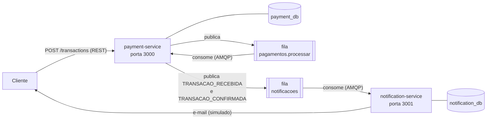

# CompreFácil – Microsserviços de Pagamento e Notificação

Desafio da Unidade Curricular **Desenvolvimento de Sistemas Distribuídos**
Curso Superior de Tecnologia em Análise e Desenvolvimento de Sistemas – UniSENAI SC
Autora: Fabíola Reginaldo Corrêa da Silva

Este projeto implementa dois microsserviços independentes em **Node.js**, que se comunicam de forma **assíncrona** por meio do **RabbitMQ** (protocolo AMQP):

| Serviço | Porta | Interfaces | Responsabilidade |
| --- | --- | --- | --- |
| `payment-service` | 3000 | REST + AMQP | Recebe a solicitação de transação, grava no banco, processa e confirma o pagamento |
| `notification-service` | 3001 | REST + AMQP | Lê as mensagens da fila e notifica o usuário sobre o recebimento e a confirmação da transação |

A infraestrutura (PostgreSQL e RabbitMQ) é criada com **docker-compose**. Cada serviço tem o **seu próprio banco de dados** (`payment_db` e `notification_db`).

## Arquitetura



## Fluxo de processamento (assíncrono)

Ao receber `POST /transactions`, o serviço de pagamento responde na hora com **HTTP 202 (Accepted)** e o restante acontece em segundo plano:

| Passo | O que acontece | Onde está no código |
| --- | --- | --- |
| I | O pagamento grava a transação com status **PENDENTE** | `payment-service/src/routes.js` → `db.createTransaction` |
| II | O pagamento publica a mensagem `TRANSACAO_RECEBIDA` na fila `notificacoes` | `payment-service/src/routes.js` → `notify(...)` |
| III | A notificação lê a mensagem e avisa o usuário do recebimento | `notification-service/src/consumer.js` |
| IV | O pagamento processa a transação (fila interna `pagamentos.processar`) e muda o status para **SUCESSO** | `payment-service/src/processor.js` → `db.confirmTransaction` |
| V | O pagamento publica a mensagem `TRANSACAO_CONFIRMADA` na fila `notificacoes` | `payment-service/src/processor.js` → `notify(...)` |
| VI | A notificação lê a mensagem e avisa o usuário da confirmação | `notification-service/src/consumer.js` |

O processamento do pagamento é simulado com uma espera de 5 segundos (variável `PROCESSING_DELAY_MS`), representando a consulta à operadora do cartão. O envio do e-mail é simulado com uma mensagem no log do serviço de notificação e fica registrado no banco `notification_db`.

## Pré-requisitos

- [Docker Desktop](https://www.docker.com/products/docker-desktop/) instalado e aberto (já inclui o docker-compose).

Para rodar sem Docker (opcional), é preciso também o [Node.js](https://nodejs.org/) 18 ou superior.

## Como executar

1. Clone o repositório e entre na pasta:

   ```bash
   git clone <URL-DESTE-REPOSITORIO>
   cd comprefacil-microsservicos
   ```

2. Suba toda a estrutura (Postgres, RabbitMQ e os dois serviços):

   ```bash
   docker compose up --build
   ```

   Aguarde até aparecerem no terminal as mensagens:

   ```
   [pagamento] API REST disponível em http://localhost:3000
   [notificacao] API REST disponível em http://localhost:3001
   ```

3. Para encerrar: `Ctrl + C` e depois `docker compose down`.

## Como testar o fluxo

### 1. Enviar uma solicitação de transação

**Linux / macOS / Git Bash:**

```bash
curl -X POST http://localhost:3000/transactions \
  -H "Content-Type: application/json" \
  -d '{"userId":"10","userEmail":"cliente@teste.com.br","orderNumber":"PED-1001","amount":259.90}'
```

**Windows (PowerShell):**

```powershell
Invoke-RestMethod -Method Post -Uri http://localhost:3000/transactions `
  -ContentType "application/json" `
  -Body '{"userId":"10","userEmail":"cliente@teste.com.br","orderNumber":"PED-1001","amount":259.90}'
```

Também é possível usar o **Postman** ou o **Insomnia**: método `POST`, URL `http://localhost:3000/transactions`, corpo (Body) do tipo JSON com os mesmos dados.

Resposta esperada (HTTP 202), com o status ainda **PENDENTE**:

```json
{
  "message": "Solicitação de transação recebida. O pagamento será processado.",
  "transaction": {
    "id": "72c499e5-ac9f-4fb8-8795-900c6b04104f",
    "userId": "10",
    "userEmail": "cliente@teste.com.br",
    "orderNumber": "PED-1001",
    "amount": 259.9,
    "status": "PENDENTE"
  }
}
```

### 2. Acompanhar o status da transação

Logo após o envio o status é `PENDENTE`; depois de cerca de 5 segundos passa a ser `SUCESSO`:

```bash
curl http://localhost:3000/transactions/<id-da-transacao>
```

### 3. Ver as notificações enviadas ao usuário

```bash
curl "http://localhost:3001/notifications?userId=10"
```

Devem aparecer duas notificações: `TRANSACAO_RECEBIDA` e `TRANSACAO_CONFIRMADA`.

### 4. Acompanhar pelos logs

No terminal do `docker compose up`, o fluxo aparece nesta ordem:

```
[pagamento] Transação 72c4... recebida e gravada (status PENDENTE)
[pagamento] Mensagem TRANSACAO_RECEBIDA publicada na fila "notificacoes"
[notificacao] Mensagem TRANSACAO_RECEBIDA lida da fila
[notificacao] >>> Enviando e-mail para cliente@teste.com.br: "Olá! Recebemos a sua solicitação de pagamento do pedido PED-1001, no valor de R$ 259,90. Ela está sendo processada."
[pagamento] Processando transação 72c4...
[pagamento] Transação 72c4... confirmada (status SUCESSO)
[pagamento] Mensagem TRANSACAO_CONFIRMADA publicada na fila "notificacoes"
[notificacao] Mensagem TRANSACAO_CONFIRMADA lida da fila
[notificacao] >>> Enviando e-mail para cliente@teste.com.br: "Pagamento confirmado! O pagamento do pedido PED-1001, no valor de R$ 259,90, foi aprovado. Obrigado por comprar na CompreFácil."
```

### 5. Painel do RabbitMQ

Acesse http://localhost:15672 (usuário `admin`, senha `admin`) e abra a aba **Queues** para ver as filas `notificacoes` e `pagamentos.processar`.

## Demonstração da independência dos serviços

Os serviços não se chamam diretamente: só trocam mensagens pela fila. Para comprovar:

```bash
# 1. Desligue apenas o serviço de notificação
docker compose stop notification-service

# 2. Envie uma transação: o pagamento continua funcionando e chega a SUCESSO
curl -X POST http://localhost:3000/transactions -H "Content-Type: application/json" \
  -d '{"userId":"20","userEmail":"outro@teste.com.br","orderNumber":"PED-2002","amount":89.50}'

# 3. No painel do RabbitMQ, a fila "notificacoes" mostra 2 mensagens aguardando

# 4. Ligue o serviço de notificação de novo
docker compose start notification-service
```

Ao voltar, o serviço de notificação lê as mensagens que ficaram guardadas na fila e envia as duas notificações. Nenhuma mensagem é perdida, porque as filas são **duráveis** e as mensagens são **persistentes**.

## Endpoints

### payment-service (porta 3000)

| Método | Rota | Descrição |
| --- | --- | --- |
| POST | `/transactions` | Solicita uma transação. Corpo: `userId`, `userEmail`, `orderNumber`, `amount` |
| GET | `/transactions/:id` | Consulta uma transação (status `PENDENTE` ou `SUCESSO`) |
| GET | `/transactions` | Lista as últimas transações |
| GET | `/health` | Verifica se o serviço está no ar |

### notification-service (porta 3001)

| Método | Rota | Descrição |
| --- | --- | --- |
| GET | `/notifications` | Lista as notificações enviadas. Filtros opcionais: `?userId=` e `?transactionId=` |
| GET | `/health` | Verifica se o serviço está no ar |

### Mensagens AMQP (fila `notificacoes`)

```json
{
  "event": "TRANSACAO_RECEBIDA",
  "sentAt": "2026-11-18T17:29:24.720Z",
  "transaction": {
    "id": "72c499e5-ac9f-4fb8-8795-900c6b04104f",
    "userId": "10",
    "userEmail": "cliente@teste.com.br",
    "orderNumber": "PED-1001",
    "amount": 259.9,
    "status": "PENDENTE"
  }
}
```

O campo `event` vale `TRANSACAO_RECEBIDA` (passo II) ou `TRANSACAO_CONFIRMADA` (passo V).

## Decisões técnicas

- **Comunicação assíncrona:** o cliente recebe a resposta (HTTP 202) sem esperar o processamento nem o envio das notificações.
- **Banco de dados por serviço:** `payment_db` pertence só ao pagamento e `notification_db` só à notificação. Um serviço nunca acessa o banco do outro.
- **Filas duráveis e mensagens persistentes:** as mensagens não se perdem se um serviço estiver fora do ar.
- **Confirmação manual (ack):** a mensagem só sai da fila depois de tratada. Se houver erro, ela volta para a fila (`nack`) e é processada de novo.
- **Proteção contra duplicidade:** a confirmação só altera transações que ainda estão `PENDENTE`, e a tabela de notificações tem uma restrição `UNIQUE (transaction_id, type)`. Assim, se uma mensagem chegar repetida, o usuário não recebe a mesma notificação duas vezes.
- **Reconexão na inicialização:** os serviços tentam conectar ao banco e ao RabbitMQ várias vezes, porque esses containers podem demorar alguns segundos para ficar prontos.

## Executar sem Docker (opcional)

Com Postgres e RabbitMQ rodando (por exemplo, só eles via `docker compose up postgres rabbitmq`):

```bash
cd payment-service
npm install
npm start
```

Em outro terminal:

```bash
cd notification-service
npm install
npm start
```

As configurações padrão estão nos arquivos `.env.example` de cada serviço.

## Estrutura do projeto

```
comprefacil-microsservicos/
├── docker-compose.yml          # Postgres, RabbitMQ e os dois serviços
├── docker/postgres/            # script que cria payment_db e notification_db
├── payment-service/
│   ├── Dockerfile
│   ├── package.json
│   └── src/
│       ├── index.js            # inicialização do serviço
│       ├── config.js           # variáveis de ambiente
│       ├── db.js               # acesso ao banco payment_db
│       ├── rabbitmq.js         # conexão AMQP e publicação de mensagens
│       ├── notifications.js    # mensagens para o serviço de notificação
│       ├── routes.js           # interface REST
│       └── processor.js        # interface AMQP: processa e confirma a transação
└── notification-service/
    ├── Dockerfile
    ├── package.json
    └── src/
        ├── index.js            # inicialização do serviço
        ├── config.js           # variáveis de ambiente
        ├── db.js               # acesso ao banco notification_db
        ├── rabbitmq.js         # conexão AMQP
        ├── consumer.js         # interface AMQP: lê a fila e envia a notificação
        └── routes.js           # interface REST
```

## Tecnologias

Node.js 20, Express, amqplib, node-postgres (pg), PostgreSQL 16, RabbitMQ 3 e Docker Compose.
